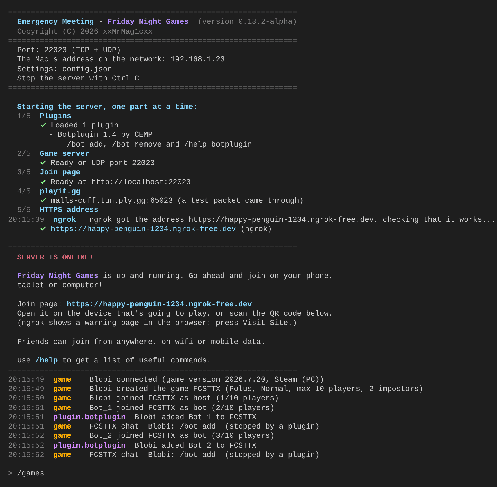
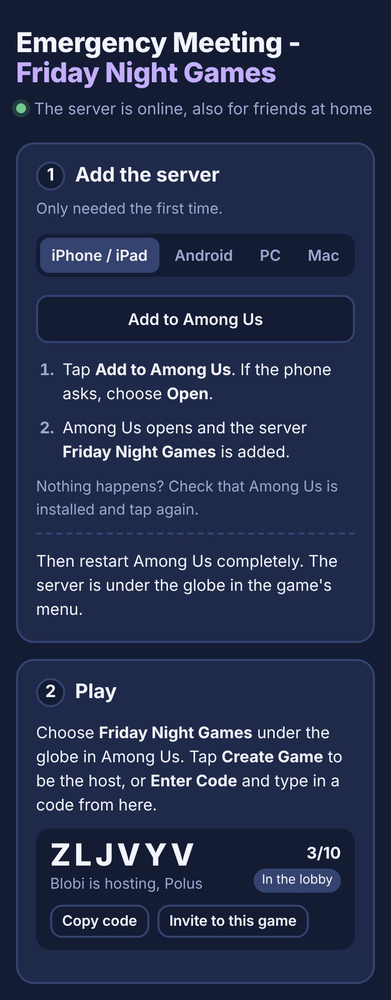

# Emergency Meeting

> **Alpha:** Emergency Meeting works on macOS, but expect bugs.
> [Report them here](https://github.com/xxMrMag1cxx/Emergency-Meeting/issues).

Emergency Meeting is a free, open source Among Us server you run on your own Mac. You and your
friends join it from your phones, tablets and computers, at home or from your
own homes, without changing anything in the router. It's written from scratch
in Python, using only what comes with Python, and it has its own plugin system.
It was made with the help of AI, see [Made with AI](#made-with-ai).

<p align="center">
  
  
</p>

## Features

- **Host and play** whole rounds: game codes, meetings, votes and kills (the
  server decides kills, like Among Us's own servers)
- **Friends can join from anywhere**, on wifi or mobile data, through
  [playit.gg](https://playit.gg) and [ngrok](https://ngrok.com). Both are free
  and nothing needs to be changed in the router
- **A join page** that shows the right steps for iPhone/iPad, Android, PC and
  Mac, the games on the server, a QR code and a ready-made message to send
  to friends
- **Plugins** in Python that react to what happens in the game, and bots that
  walk around and do tasks
- **A Terminal window** with colors, commands (`/help`) and English or Swedish

## Requirements

- A Mac with **macOS 12 Monterey or newer** (Intel or Apple silicon). So far
  it's tested on a MacBook Pro (Intel) with macOS 12.7
- **Python 3.8 or newer** (see [step 1](#1-check-that-python-is-there))
- Free accounts at **ngrok** and **playit.gg**, so that friends can join from
  their own homes (without them, only devices on your wifi can join)
- **Among Us** on iPhone/iPad, Android, PC (Steam, Epic, Microsoft Store) or a
  Mac with Apple silicon. Consoles (Switch, Xbox, PlayStation) can't join
  custom servers

## Quick start

1. Download the latest version from
   [Releases](https://github.com/xxMrMag1cxx/Emergency-Meeting/releases)
   (**Source code (zip)** under Assets) and unpack it.
2. Double-click **`start.command`**. The first time, a short guide asks for
   the language, a name for your server, a key from ngrok and a link to
   approve on playit.gg, one thing at a time.
3. When the box **SERVER IS ONLINE!** shows up, open the join page address on
   your phone (or scan the QR code), tap **Add to Among Us** and restart
   Among Us.
4. Choose your server under the globe in Among Us and tap **Create Game**.
   Send the join page to your friends.

The rest of this README explains every step in detail.

## Get started on the Mac

### 1. Check that Python is there

Open **Terminal** (in Applications → Utilities) and type:

```
python3 --version
```

If it says `Python 3.8` or higher, everything is ready. If it says something
else, download the latest Python from <https://www.python.org/downloads/macos/>
(choose "macOS 64-bit universal2 installer") and install it.

### 2. Get the code

Download the latest version from
[Releases](https://github.com/xxMrMag1cxx/Emergency-Meeting/releases): under
**Assets**, click **Source code (zip)**. Unpack it. It doesn't matter where the folder ends up, all the files below
are started with a double-click in Finder.

> The first time macOS says a file can't be opened because it comes from the
> internet: right-click the file, choose **Open** and then **Open** again.

### 3. Start the server

Double-click **`start.command`**. If macOS asks if Python may accept
incoming connections, choose **Allow**.

The first time, a short guide asks for four things, one at a time. They are
only needed once:

1. **Select server language**: choose **English** or **Swedish** with the
   arrow keys and press Enter. That is the language of the server's Terminal
   window, see [Language](#language).
2. **NAME YOUR SERVER**: type a name for the server and press Enter (or
   just Enter to keep *Emergency Meeting*). The name shows up as the region in
   Among Us and on the join page. It can be changed later with
   `/changeservername`, see [Commands](#commands).
3. **FIXED HTTPS ADDRESS WITH NGROK**: paste a key from ngrok, see
   [Fixed HTTPS address with ngrok](#fixed-https-address-with-ngrok).
   Press Enter to skip it.
4. **CONNECT THE SERVER TO PLAYIT.GG**: open a link and approve the server.
   The server then gets a tunnel from playit.gg and waits until its address
   works, see [Play with friends from home](#play-with-friends-from-home).
   Press Enter to skip it.

Then the server starts, one part at a time. Each part starts when the one
before is completely ready and has been checked:

```
  Starting the server, one part at a time:
  1/5  Plugins
       ✓ Loaded 1 plugin
  2/5  Game server
       ✓ Ready on UDP port 22023
  3/5  Join page
       ✓ Ready at http://localhost:22023
  4/5  playit.gg
       ✓ malls-cuff.tun.ply.gg:65023 (a test packet came through)
  5/5  HTTPS address
       ✓ https://happy-penguin-1234.ngrok-free.dev (ngrok)
```

When all parts are ready, the box **SERVER IS ONLINE!** shows the join page's
address and a QR code. Then you can join, see
[Connecting with Among Us](#connecting-with-among-us). The address is the same
every time the server starts.

If a part doesn't start, the server says what went wrong and restarts itself
once (`/reboot`). If it goes wrong again, the server starts the rest as well
as it can (for example Cloudflare instead of ngrok) and shows the box
**SOMETHING ISN'T WORKING** with what to do. When you have fixed it, type
`/reload` or `/reboot`.

Stop the server with **Ctrl+C** (or type `/stop`).

### 4. Get cloudflared (optional backup)

If ngrok doesn't work, the server can use a free HTTPS address from
Cloudflare instead (no account needed, but the address changes every start).
Double-click **`get-cloudflared.command`** once to download the program
`cloudflared`. The script picks a version that works on your macOS by itself.

### 5. Test without the game (optional)

Leave the server running and double-click **`test.command`**. The test client
pretends to be two Among Us players: one hosts a game, the other joins with
the game code. If everything works it prints `Everything works!`.

### Updating to a new version

Download the new ZIP from
[Releases](https://github.com/xxMrMag1cxx/Emergency-Meeting/releases) and move
these from the old folder, so that you don't have to redo the things that are
only needed the first time:

- `config.json` (the settings, the server's name and language)
- `playit-key.txt`, `ngrok-key.txt` and `ngrok-address.txt`
- `cloudflared` and the `plugins` folder

> Coming from 0.12.0 or older? Those files had Swedish names then
> (`playit-nyckel.txt`, `ngrok-nyckel.txt`, `ngrok-adress.txt` and the
> `loggar` folder). Just move them over as they are, the server gives them
> their new names by itself.

## Connecting with Among Us

With playit.gg (see [below](#play-with-friends-from-home)) the player can be
anywhere. Without playit.gg the device must be on the **same wifi** as the Mac.

1. Open the HTTPS address the server printed in a browser on the device
   that will play, or scan the QR code in the Terminal window with the
   phone camera.
2. The page shows the steps for that device (iPhone/iPad, Android, PC or
   Mac). On phones it's enough to tap the button **Add to Among Us**. On a
   PC you download `regionInfo.json`, and the page has a button that copies
   the address of the folder where the file should go.
3. Restart Among Us completely, choose your server under the globe and tap
   **Create Game**, or **Enter Code** and type in a code.

You only have to do steps 1–2 once. After that, you just choose the server
in Among Us.

### The join page

The join page has three parts:

- **Add the server**: the steps for the device you use. Wrong device? Switch
  with the tabs at the top.
- **Play**: all games on the server with game code, host, map and number of
  players. The list updates by itself. **Copy code** puts the code on the
  clipboard.
- **Invite friends**: a QR code and a ready-made message. Tap **Invite to this
  game** next to a game, and the code is included in the message. Copy it
  or tap **Share** (on the phone) and send it in a chat.

If you open `http://localhost:22023` on the Mac, it shows the address the
friends should use, with a big QR code, the games and the message.

## Fixed HTTPS address with ngrok

Among Us requires HTTPS when the game and the server are on different
devices. **ngrok** (free) gives the server an HTTPS address that is the same
every time, for example `https://happy-penguin-1234.ngrok-free.dev`. Then
friends only have to add the server to Among Us once.

### The first time (only the host)

1. Start the server. It shows the box **FIXED HTTPS ADDRESS WITH NGROK**.
2. Create a free account at <https://dashboard.ngrok.com/signup> (or log
   in).
3. Open <https://dashboard.ngrok.com/get-started/your-authtoken> and copy
   your **Authtoken**.
4. Click in the Terminal window, paste the key (Cmd+V) and press **Enter**.
   The key doesn't show when you paste it, because it's secret. It doesn't
   matter if other lines show up in the window meanwhile.
5. The server downloads the program ngrok by itself and then prints
   **HTTPS IS READY!** with the new address.

The key is saved in `ngrok-key.txt` and the address in `ngrok-address.txt`.

Until the key is pasted, Cloudflare is used (if you have downloaded
cloudflared). Just press Enter if you want to skip ngrok that time.

### Good to know

- The first time you open the address in a browser, ngrok shows a warning
  page. Tap **Visit Site**. The game itself gets no warning page.
- If ngrok doesn't get going within 40 seconds, the server uses Cloudflare
  instead. The box **HTTPS IS READY!** says which address to use.
- The free account is plenty: ngrok allows 20,000 requests a month, and a
  player who joins only makes a few.
- If someone else has seen the key, for example in a screenshot or a copied
  log: create a new one at
  <https://dashboard.ngrok.com/get-started/your-authtoken> (**Reset
  Authtoken**). The next time the server starts it says that the key doesn't
  work and asks for the new one.
- If you only want to use Cloudflare: set `"ngrok": false` in `config.json`.

## Play with friends from home

The server uses **playit.gg** (free) so that friends can play with you from
their own homes, on wifi or mobile data. Nothing needs to be changed in the
router. The game gets a fixed address at playit.gg that is the same every
time.

### The first time (only the host)

1. Start the server. In the guide it shows the box **CONNECT THE SERVER TO
   PLAYIT.GG** with a link, for example `https://playit.gg/claim/3fa91c0d2e`.
2. Open the link in a browser. Log in, or create a free account, and
   approve the server.
3. The server then creates a tunnel at playit.gg by itself. If that doesn't
   work, it shows the box **CREATE A TUNNEL ON PLAYIT.GG** with playit.gg's
   answer and what to click on playit.gg. The server notices by itself when
   the tunnel is ready.
4. The server waits until the tunnel's address works (the first time it can
   take a few minutes) and says **playit.gg is set up!**.

The server saves a secret key in `playit-key.txt`. After that everything
happens by itself every time the server starts.

### How friends join

Just like on wifi: they open the HTTPS address the server printed, tap
**Add to Among Us**, restart the game, choose your server and type in the
game code. Send them the address in a chat (the join page has a ready-made
message). The next time they just choose your server in the game.

Phones don't need the "Local Network" permission, because the game goes
through the internet instead of directly to the Mac.

### If something goes wrong

- **"playit.gg wants you to confirm your email first"**: open the link, confirm
  your email on playit.gg and wait a moment. The server finds the tunnel by
  itself, or type `/reload`.
- **PLAYIT.GG DOESN'T RECOGNIZE THE SERVER**: the key doesn't work anymore
  (for example if the server was removed on playit.gg). Delete
  `playit-key.txt` and restart the server, and a new link comes up.
- **"playit.gg isn't here"** in the log: the file `playit/playitd-macos` is
  missing. Download the ZIP again, or double-click `build-playit.command`
  (see [playit/README.md](playit/README.md)).
- If you only want to play on your wifi: set `"playit": false` in `config.json`.

## Language

Everything in Emergency Meeting is in English: the join page, the files and
the chat messages in the game. Only the server's **Terminal window** (the one
`start.command` opens) can be in Swedish instead.

The language is chosen the first time the server starts. Change it with
`/language English` or `/language Swedish` while the server is running, or
with `"language"` in `config.json`. The change is saved in `config.json`.

The translations are in `server/locales/sv.json`. Run
`python3 tools/check_translations.py` to find text that has no translation
yet. Plugins can bring their own translations, see
[plugins/README.md](plugins/README.md).

## Commands

While the server is running you can type commands in the Terminal window and
press Enter:

| Command | What it does |
|---------|--------------|
| `/help` | Shows all commands |
| `/changeservername <name>` | Changes the server's name, for example `/changeservername Friday Night Games` |
| `/games` | Shows the games on the server with game code, number of players and map |
| `/address` | Shows the join page's address and the QR code again |
| `/say <message>` | Sends a chat message to everyone in all games |
| `/language <English\|Swedish>` | Changes the language in the Terminal window |
| `/reload` | Starts playit.gg and the HTTPS address again, one at a time. Friends playing from home are disconnected |
| `/reboot` | Restarts the whole server in the same window. Everyone is disconnected |
| `/stop` | Stops the server (the same as Ctrl+C) |

If a room is online, `/reload` and `/reboot` first show a warning with the
rooms' codes and ask you to type `yes` or `no`.

When the server changes its name, the region in `regionInfo.json`, the button
on the join page and the heading change right away. Those who have already
added the server see the old name in Among Us until they add the server
again from the join page. You can play anyway, the address is the same.

## What the log shows

The server prints what happens, for example:

```
15:01:12  game    Blobi created the game NUORZH (The Skeld, Normal, max 10 players, 1 impostor)
15:01:12  game    Blobi joined NUORZH as host (1/10 players)
15:02:40  game    NUORZH: Blobi has the color Lime
15:03:05  game    NUORZH: Blobi changed Kill Cooldown: 30 s -> 25 s
15:03:30  game    Kalle joined NUORZH as player (2/10 players)
15:03:41  game    NUORZH chat  Kalle: hi!
15:05:02  game    NUORZH: the game is starting! (4 players, The Skeld)
15:06:10  game    NUORZH: Bot_2 has been killed! (1 dead)
15:06:30  game    NUORZH: MEETING! Blobi found Bot_2
15:07:05  game    NUORZH: Bot_1 was voted out
15:07:20  game    NUORZH: THE ROUND IS OVER. The crew won by voting out the impostors
15:07:20  game    NUORZH:   Impostors: Bot_1
15:07:20  game    NUORZH:   Bot_2 was killed by Bot_1
```

During the round the log doesn't say who killed someone or who the impostors
are, so that whoever watches the server window doesn't find out. That only
comes in the summary when the round is over.

The log has colors: the boxes' titles are red and every kind of line has its
own color (the server and the games orange, playit.gg yellow, ngrok blue,
HTTP green, bots turquoise and plugins purple). Warnings are yellow and
errors red. The colors follow whether the Mac is in dark or light mode. If
you want other colors or none, there are `color_theme` and `colors` in
`config.json`.

The settings have the same names as in the game's menu. If the game gets a
new setting that the server doesn't know about, it says "Other settings".

## Plugins

The `plugins/` folder is for plugins that the server loads when it starts.
A plugin is a Python file that can react to things that happen (someone
joins, writes in the chat, changes settings...) and send chat messages or
add bots itself.

An easy way to get started with plugins is by downloading
[CEMP (Common Emergency Meeting Plugins)](https://github.com/xxMrMag1cxx/Common-Emergency-Meeting-Plugins),
our collection of ready-made plugins. Download it as a ZIP, unpack it, put
the whole folder in `plugins/` and restart the server.

How to write your own plugins is in [plugins/README.md](plugins/README.md).

## The server's settings

The server's own settings are in `config.json`. The file is created the first
time the server starts. Change it with TextEdit when the server is off.

| Setting            | What it does |
|--------------------|--------------|
| `server_name`      | The server's name (asked the first time, change it with `/changeservername`) |
| `language`         | The language in the Terminal window: `English` or `Swedish` (asked the first time, change it with `/language`) |
| `listen_ip`        | `0.0.0.0` = listen on all networks. Rarely needs to be changed |
| `port`             | Port for both HTTP and the game. Among Us uses `22023` |
| `public_ip`        | `auto` = the Mac's address on the home network. Can be set to your own address |
| `https_tunnel`     | `true` = start an HTTPS tunnel (ngrok, otherwise cloudflared) |
| `ngrok`            | `true` = use ngrok, so that the HTTPS address is the same every time |
| `ngrok_path`       | `auto` = look for ngrok by itself (the `ngrok/` folder first) and download it if it's missing |
| `cloudflared_path` | `auto` = look for cloudflared by itself (the project folder first) |
| `playit`           | `true` = make the game reachable from home with playit.gg |
| `playit_path`      | `auto` = look for playitd by itself (the `playit/` folder first) |
| `plugins`          | `true` = load plugins from the `plugins/` folder |
| `page_shows_games` | `true` = show the games and their codes on the join page |
| `terminal_qr`      | `true` = show the HTTPS address as a QR code in the Terminal window |
| `colors`           | `true` = colors in the Terminal window |
| `color_theme`      | `auto` = follow the Mac's dark/light mode, `dark` = for a black background, `light` = for a white background |
| `debug`            | `true` = show every packet in the log, good for troubleshooting |

## Known limitations

This is an alpha, so some things are missing or rough:

- Only tested on macOS. Linux will probably work, Windows isn't supported yet.
- Consoles (Switch, Xbox, PlayStation) can't join, because they don't allow
  custom servers.
- Anyone who has the join page address can add the server. They still need
  a game code to join a game, so only share the address with friends.
- The Mac has to be awake and running the server while you play.
- Everyone should have the same (or almost the same) version of Among Us as
  the host. The server warns in the log if the versions differ.

## Troubleshooting

- **SOMETHING ISN'T WORKING**: the box says which part didn't start and what
  to do. After fixing it, type `/reload` (playit.gg and the HTTPS address) or
  `/reboot` (the whole server).
- **Black screen and nothing happens in the server window**: the game doesn't
  reach the server. Check that you use the HTTPS address from the *latest*
  start of the server. With ngrok the address is the same every time, but if
  the box **HTTPS IS READY!** shows a `trycloudflare.com` address, the server
  has used Cloudflare instead.
- **NGROK DOESN'T RECOGNIZE THE KEY**: paste a new key from
  <https://dashboard.ngrok.com/get-started/your-authtoken> in the Terminal window.
- **NGROK IS ALREADY IN USE**: the ngrok account is used by another computer
  or program. Close it and restart the server.
- **"tried to connect with HTTPS directly to port 22023"** in the log: the game
  is set to the Mac's IP address instead of the HTTPS address. Add the server
  again through the HTTPS address.
- **"reached the server over HTTPS but never connected to the game over UDP"**
  in the log: the device reaches the server over the internet but not the game
  itself. Check that the box **PLAYIT IS READY!** has been shown. Without
  playit.gg the device must be on the same wifi, and on an iPhone: Settings →
  Privacy & Security → Local Network → turn on Among Us.
- **A token is fetched but nothing more happens**: the game reaches the HTTPS
  part but not UDP. Check that the device is on the same wifi and that the
  firewall allows Python (System Preferences → Security & Privacy → Firewall).
- **The game gets stuck after Create Game** or the lobby looks strange: set
  `"debug": true` in `config.json`, try again and save the log. It shows
  exactly what the game and the server send to each other.
- **"Address already in use"**: the server is already running in another
  window. Close it.
- **Someone is disconnected unexpectedly**: every time a player in a game is
  disconnected, a report is saved in the `logs/` folder with the latest
  messages between the game and the server. Attach that file when you report
  the problem.

Found a bug? [Open an issue](https://github.com/xxMrMag1cxx/Emergency-Meeting/issues)
with the text from the Terminal window and, if someone was disconnected, the
file from `logs/`.

## Made with AI

Emergency Meeting was made with the help of AI. Most of the code and the
texts (including this README) were written by
[Claude](https://www.anthropic.com/claude), an AI assistant made by Anthropic,
based on our ideas, tests and feedback. We decide what to build, test every
version with the real game and report what doesn't work. We say this so that
nobody is misled about how the project was made.

## Keep your keys secret

`ngrok-key.txt` and `playit-key.txt` give access to your ngrok and playit.gg
accounts. Don't share them, and don't paste them in issues or screenshots.
They are excluded in `.gitignore`, so they don't end up on GitHub if you put
your own copy of the server there.

## How it works

```
Among Us --HTTPS--> ngrok -------tunnel--> ngrok -------HTTP---> the server (TCP 22023)
Among Us --UDP----> playit.gg ---tunnel--> playitd -----UDP----> the server (UDP 22023)
```

If ngrok doesn't work, HTTPS goes through Cloudflare instead (the program
cloudflared). Without playit.gg (or if the game asks the server directly,
without HTTPS) UDP goes directly from the game to the Mac on your wifi.

1. The game asks the server over **HTTPS**: "Can I have a token?" and "Where
   should I host the game?". The server answers with the playit.gg address
   (or the Mac's address on the home network if playit.gg isn't used).
2. The game sends a **Hello** packet to the server over **UDP** with its
   name and version.
3. The game sends **HostGame** with the settings. The server creates a lobby
   and answers with the game code.
4. The game sends **JoinGame** with the code. The server answers
   **JoinedGame**, and the first one to join becomes the host.
5. The game loads the lobby. The server creates a **player info** object for
   the player (where the game saves name, color and hat).
6. After that the host sends **GameData** all the time (movements, color
   changes, chat...). The server passes it all on to the others in the lobby.

### The order the server starts in

The server starts from the inside out, one part at a time, and checks each part
before the next one starts:

1. **Plugins**, so that they are ready before any player can connect.
2. **The game server** (UDP), checked with a test packet to itself.
3. **The join page** (HTTP), checked by fetching its own page. ngrok and
   Cloudflare send their traffic here.
4. **playit.gg**, which sends the game from the internet to the game server,
   so the game server must already run. Checked with a test packet through the
   playit.gg address.
5. **HTTPS** (ngrok, otherwise Cloudflare) last, because the join page hands
   out the playit.gg address. If HTTPS opened first, a friend could get the
   wrong address. Checked by fetching the page through HTTPS.

`/reload` runs steps 4 and 5 again.

### Who decides what

Most of the game logic runs at the host. The server keeps track of who is in
which game, passes the messages on, and decides kills: the game asks the
server ("CheckMurder"), and the server checks that the killer is a living
impostor, that the victim is alive and isn't an impostor and that no meeting
is going on, before it sends "MurderPlayer" to everyone.

### How the code is organized

```
server/
  __main__.py    the starting point: the guide the first time, then startup.py
  config.py      reads and saves config.json
  startup.py     starts everything one part at a time, /reload, /reboot and the commands
  wizard.py      the guide the first time the server starts
  terminal.py    colors, boxes, the steps, the language menu, the server name and /help
  i18n.py        translations for the Terminal window
  locales/       the translations (sv.json = Swedish)
  matchmaker.py  the HTTP part: the game asks where the server is
  ngrok.py       starts ngrok: an HTTPS address that is the same every time
  tunnel.py      starts cloudflared (backup): an HTTPS address that changes every time
  playit.py      starts playitd and keeps an eye on the playit.gg tunnel
  webpage.py     the join page: adding the server, game codes, invitation
  qrcode.py      QR codes (for the terminal and the join page)
  region.py      builds regionInfo.json and the amongus:// link
  hazel.py       the network layer: acks, pings and resending packets
  handshake.py   reads the game's first packet (name, version, platform)
  game.py        the game logic: hosting, joining, passing on game data
  lobby.py       a lobby: game code, players, host and player info
  options.py     reads the game settings and shows what changed
  plugins.py     loads plugins and calls them when something happens
  bots.py        bots: pretend players that the server controls
  navigation.py  finds paths around the walls for bots
  mapdata/       the maps: walls, tasks, rooms and start places
  blackbox.py    "black box": saves what happened if someone is disconnected
  gamecode.py    game codes ("ABCDEF") and the numbers the game sends
  messages.py    reading and writing bytes
  protocol.py    all numbers and names Among Us uses
plugins/         plugins that the server loads (see plugins/README.md)
playit/          playitd, playit.gg's tunnel program (see playit/README.md)
docs/            the pictures in this README
tools/
  testclient.py         two pretend Among Us games that test the server (host,
                        join, change color, change settings, chat, leave)
  check_translations.py finds text in the Terminal window that has no translation
start.command               starts the server
test.command                runs the test client
get-cloudflared.command     downloads cloudflared
build-playit.command        builds playitd on the Mac (rarely needed)
.github/workflows/          GitHub builds playitd for Mac
```

All versions and what changed are in [CHANGELOG.md](CHANGELOG.md).

## Thanks

The protocol was mapped with the help of the open project
[Impostor](https://github.com/Impostor/Impostor), which we use as a
reference. No code is copied from there.

The map data in `server/mapdata/` comes from other open projects, see
[server/mapdata/README.md](server/mapdata/README.md).

## License

Emergency Meeting is free software under the
[GNU General Public License v3.0](LICENSE). You may use, change and share it,
as long as what you share is under the same license.

- The map data in `server/mapdata/` is also GPL-3.0 (from the projects listed
  in [server/mapdata/README.md](server/mapdata/README.md)).
- `playit/playitd-macos` is built from playit.gg's open source code and has
  its own license, BSD-2-Clause (`playit/LICENSE-playit.txt`).

Emergency Meeting is a fan project and has nothing to do with Innersloth.
Among Us is a trademark of Innersloth LLC.
